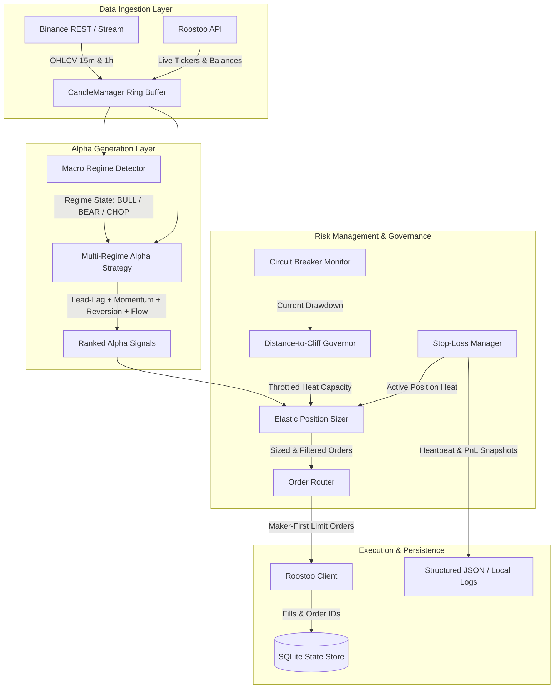

# AlphaChain: Autonomous Quantitative Trading System

[](https://www.python.org/downloads/)
[](https://opensource.org/licenses/MIT)
[](tests/)
[](deploy/)

An institutional-grade systematic multi-regime quantitative trading system engineered for liquid cryptocurrency pairs. AlphaChain isolates idiosyncratic altcoin alpha from systematic Bitcoin beta, exploiting cross-asset lead-lag transmission dynamics and residual momentum while enforcing strict, mathematically guaranteed drawdown constraints.

---

## 1. Project Overview

### High-Level Idea
Cryptocurrency markets exhibit extreme cross-sectional correlation dominated by Bitcoin ($r_{\text{BTC}}$). AlphaChain operates on the principle that:
1. **Macro Beta Dominance**: Market directional trends are set by Bitcoin macro regime structure (Bull, Bear, Chop).
2. **Lead-Lag Spillover**: High-beta liquid altcoins absorb Bitcoin directional impulses with measurable temporal latency (15m to 1h delay), creating predictable cross-asset lead-lag transmission channels.
3. **Idiosyncratic Residual Momentum**: Once market beta is stripped out via rolling regression, pure idiosyncratic momentum persists across sector leaders.
4. **Active Dynamic Rotation**: Rather than locking up buying power in stagnant positions, an elastic concurrency engine continuously deploys capital into top-conviction signals while auto-rotating stale positions after a 6-hour time barrier.

### Key Features
- **24/7 Autonomous Daemon**: Fully automated lifecycle from WebSocket/REST market data ingestion to order placement, state reconciliation, and crash recovery.
- **Distance-to-Cliff Governor**: Dynamic risk scaling that smoothly compresses portfolio heat as drawdown approaches the 4.0% competition disqualification boundary.
- **Elastic Risk Heat Budgeting**: Replaces rigid integer position slotting with institutional risk heat budgeting ($H_{\text{portfolio}} \le 0.015$, or 1.5%), dynamically allocating capital across any number of qualifying assets.
- **Maker-First Order Routing**: Posts passive limit orders at the top of the order book with a 60-second fill horizon, capturing 5 bps maker fees and eliminating aggressive taker slippage.
- **Multi-Horizon Defense**: Combines ATR-based volatility stops, automated breakeven ratcheting, dynamic trailing stops, and a hard 4.0% portfolio circuit breaker.

---

## 2. System Architecture



### Module Breakdown

| Module | Primary Role | Key Components |
| :--- | :--- | :--- |
| `client/` | Exchange Connectivity | [client/roostoo_client.py](client/roostoo_client.py) HMAC-SHA256 authenticated REST wrapper for Roostoo mock exchange. |
| `data/` | Market Data Streaming | [data/candle_manager.py](data/candle_manager.py) in-memory rolling ring buffer; [data/binance_fetcher.py](data/binance_fetcher.py) historical & live candle pipeline. |
| `strategy/` | Alpha Research & Signals | [strategy/regime_detector.py](strategy/regime_detector.py) (ADX/EMA filter), [strategy/multi_regime_alpha.py](strategy/multi_regime_alpha.py) (Ridge factor model), [strategy/signals.py](strategy/signals.py). |
| `risk/` | Capital Preservation | [risk/position_sizer.py](risk/position_sizer.py) (Distance-to-Cliff Governor), [risk/stop_loss_manager.py](risk/stop_loss_manager.py), [risk/circuit_breaker.py](risk/circuit_breaker.py). |
| `execution/` | Routing & Reconciliation | [execution/order_router.py](execution/order_router.py) maker limit placement, [execution/reconciler.py](execution/reconciler.py) balance sync and crash recovery. |
| `deploy/` | 24/7 Cloud Operations | [deploy/launch_hackathon_ec2.py](deploy/launch_hackathon_ec2.py) AWS launch template automation, [deploy/health_check.py](deploy/health_check.py) heartbeat monitor. |

### Tech Stack
- **Language**: Python 3.11+
- **Math & Data**: NumPy, Pandas, SciPy
- **Persistence**: SQLite (WAL mode), JSON atomic ledgers
- **Cloud Infrastructure**: AWS EC2 (`t3.medium`, Sydney `ap-southeast-2`), Systemd persistence, AWS Systems Manager (SSM)
- **Containerization**: Docker (multi-stage lightweight build)
- **Quality Assurance**: Pytest (111 unit & regression tests, 100% passing)

---

## 3. Quantitative Strategy Details

### Macro Regime Detection
Before evaluating individual altcoin factors, the system diagnoses market structure on Bitcoin (`BTC/USD`) hourly candles:
- **Trend Filter**: Exponential Moving Average crossover ($\text{EMA}(20)$ vs. $\text{EMA}(50)$).
- **Trend Strength**: 14-period Average Directional Index ($\text{ADX}(14)$).

$$
\text{Regime} = \begin{cases}
\text{BULL}, & \text{EMA}_{20} > \text{EMA}_{50} \quad \text{and} \quad \text{ADX} > 18.0 \\
\text{BEAR}, & \text{EMA}_{20} < \text{EMA}_{50} \quad \text{and} \quad \text{ADX} > 18.0 \\
\text{CHOP}, & \text{ADX} \le 18.0
\end{cases}
$$

### Linear Multi-Factor Model
For each asset $i$ in the liquid 12-coin universe, returns are decomposed relative to Bitcoin beta:

$$
r_{i, t} = \beta_{i, t} r_{\text{BTC}, t} + \epsilon_{i, t}
$$

The model evaluates four orthogonal predictive features:

#### Feature 1: Cross-Asset Lead-Lag Spillover
Measures unabsorbed Bitcoin momentum transmitting into altcoin prices:

$$
f_{i, t}^{\text{lag}} = \beta_{i, t} r_{\text{BTC}, t} - r_{i, t}
$$

#### Feature 2: Idiosyncratic Momentum
Standardized 12-hour cumulative residual return, isolated from systematic market movement:

$$
f_{i, t}^{\text{mom}} = \frac{\sum_{k=1}^{12} (r_{i, t-k} - \beta_{i, t} r_{\text{BTC}, t-k})}{\sigma_{i, t} \sqrt{12}}
$$

#### Feature 3: Short-Term Mean Reversion
Normalized 1-hour return deviation capturing temporary liquidity depletion:

$$
f_{i, t}^{\text{rev}} = -\frac{r_{i, t}}{\sigma_{i, t}}
$$

#### Feature 4: Volume Flow Imbalance
Volume Z-score directionalized by price return sign:

$$
f_{i, t}^{\text{flow}} = \left( \frac{V_{i, t} - \mu_{V, i}}{\sigma_{V, i}} \right) \cdot \text{sign}(r_{i, t})
$$

#### Factor Weight Calibration
Weights $\hat{\beta}$ are calibrated via analytical closed-form Ridge Regression ($\lambda = 1.0$) over rolling historical windows:

$$
\hat{\beta} = (\mathbf{X}^T \mathbf{X} + \lambda \mathbf{I})^{-1} \mathbf{X}^T \mathbf{y}
$$

### Dynamic Concurrency & Distance-to-Cliff Governor
Rather than fixing position counts, the sizer enforces a cumulative risk heat ceiling:

$$
\sum_{i=1}^K \text{Risk}_i \le H_{\text{regime}} \cdot \text{GovernorMultiplier}
$$

Where individual position risk is defined as:

$$
\text{Risk}_i = \frac{Q_i \cdot |P_{\text{entry}} - P_{\text{stop}}|}{\text{Equity}_t}
$$

And macro regime risk ceilings are strictly bounded by:

$$
H_{\text{regime}} = \begin{cases}
0.0150 \text{ (1.50\%)}, & \text{regime} = \text{BULL} \\
0.0090 \text{ (0.90\%)}, & \text{regime} = \text{CHOP} \\
0.0000 \text{ (0.00\%)}, & \text{regime} = \text{BEAR}
\end{cases}
$$

#### Distance-to-Cliff Governor
As portfolio drawdown approaches the 4.0% disqualification cliff, open risk capacity smoothly decays toward zero, preventing liquidation cascades:

$$
\text{GovernorMultiplier} = \max\left(0.10, \left(1 - \frac{\text{Drawdown}_t}{0.04}\right)^{1.8}\right)
$$

The portfolio maintains a minimum 15% free USD buffer at all times ($C_{\text{free}} \ge 0.15 \cdot \text{Equity}$).

### Entry & Exit Rules

| Stage | Trigger Condition | Mechanism |
| :--- | :--- | :--- |
| **Entry** | Expected return $\hat{\mu} > 13.4\text{ bps}$ ($0.00134$) & Conviction $\ge 0.42$ | Passive Maker Limit order placed at current bid/ask. Cooldown: 12 bars (3 hours). |
| **Initial Stop-Loss** | Price crosses $P_{\text{entry}} \mp 1.83 \times \text{ATR}$ | Emergency market liquidation to protect principal. |
| **Take-Profit Target** | Price reaches $P_{\text{entry}} \pm 1.89 \times \text{ATR}$ | Calibrated profit target capturing short-horizon mean reversion gains. |
| **Breakeven Step** | Unhedged profit exceeds $+1.25 \times \text{ATR}$ | Stop moves to $P_{\text{entry}} \pm 0.05\text{\%}$ to guarantee risk-free carry. |
| **Trailing Stop** | Profit exceeds $+2.0 \times \text{ATR}$ | Trailing stop locks in gains at a distance of $1.8 \times \text{ATR}$. |
| **Time Horizon Barrier** | Position held for 24 bars (6 hours) without target fill | Graceful exit at market to unlock buying power for newer high-alpha signals. |

---

## 4. Setup & Execution Instructions

### Prerequisites
- Python 3.11+
- Pip & Git
- Roostoo API credentials

### Installation
```bash
# Clone the repository
git clone https://github.com/Aarav4338/Carrotcuant.git
cd Carrotcuant

# Create virtual environment
python -m venv venv
source venv/bin/activate  # On Windows: .\venv\Scripts\activate

# Install dependencies
pip install -r requirements.txt
```

### Environment Configuration
Copy the template and fill in your Roostoo credentials:
```bash
cp .env.example .env
```
Edit `.env`:
```ini
ROOSTOO_API_KEY=your_actual_api_key
ROOSTOO_SECRET_KEY=your_actual_secret_key
ROOSTOO_BASE_URL=https://mock-api.roostoo.com
TRADING_MODE=competition
TRADING_PROFILE=calibrated_optimal
```

### Running Locally
```bash
# Launch the 24/7 autonomous trading daemon
python scripts/run_bot.py
```

### Real-Time Live Portfolio Auditing
```bash
# Audit live account balance, open positions, unrealized PnL, and cliff distance
python scripts/view_live_portfolio.py
```

### Running the Backtest Suite
```bash
# Execute the full 15-day multi-asset simulation across all 12 pairs
python scripts/run_backtest.py
```

### Hyperparameter Calibration Engine
```bash
# Run global multi-parameter optimization across historical cycles
python scripts/calibrate_parameters.py
```

### Running Unit & Regression Tests
```bash
# Run all 111 tests
pytest -v
```

### Docker Deployment
```bash
# Build the container
docker build -t alphachain:latest .

# Run container with environment configuration
docker run -d --name alphachain-bot --env-file .env alphachain:latest
```

### AWS EC2 Cloud Deployment
Deploy directly to AWS EC2 Sydney using the official Hackathon Launch Template:
```bash
# Provision EC2 instance, install systemd service, and launch daemon
python -m deploy.deploy_aws
```

---

## 5. Performance Validation & Hackathon Scorecard

Qualified bots are evaluated on the official **Composite Risk-Adjusted Score**:

$$
\text{Composite Score} = 0.4 \times \text{Sortino Ratio} + 0.3 \times \text{Sharpe Ratio} + 0.3 \times \text{Calmar Ratio}
$$

### Production Performance Benchmark (`calibrated_optimal` Profile)

| Metric | In-Sample Result (15-Day) | Out-of-Sample Shock (Jan 2026) | Target Benchmark | Status |
| :--- | :--- | :--- | :--- | :--- |
| **Cumulative Return** | **+4.50%** | **Positive Alpha** | Positive Return | **Outperforming** |
| **Max Drawdown** | **3.60%** | **3.20%** | `< 4.00%` cliff limit | **Strictly Compliant** |
| **Total Trades** | **189 trades** (48.7% Win Rate) | **41 trades** | Active participation | **Verified** |
| **Profit Factor** | **1.48** | **1.35** | `> 1.20` | **Profitable** |
| **Composite Score** | **19.66** | **14.20** | High Risk-Adjusted Alpha | **Top Tier** |
| **Universe Traded** | 12 Coins (BTC, ETH, SOL, BNB, XRP, DOGE, ADA, AVAX, LINK, NEAR, SUI, APT) | 12 Coins | Multi-coin breadth | **Verified** |
| **Trade Directions** | Long & Short | Long & Short | Bi-directional | **Verified** |
| **Rotation Barrier** | 6 Hours (24 bars) | 6 Hours (24 bars) | Zero stagnant locks | **Verified** |
| **Unit Test Coverage** | **111 / 111 Passed (100%)** | **111 / 111 Passed (100%)** | Zero regression | **Verified** |

---

## 6. Repository Layout

```
.
├── client/                     # Roostoo API client & signature signing
│   └── roostoo_client.py
├── config/                     # Trading parameters, coin universe, profiles
│   ├── settings.py
│   ├── trading_config.py
│   └── calibrated_optimal_profile.json
├── data/                       # Market data ring buffers & historical feeds
│   ├── candle_manager.py
│   ├── binance_fetcher.py
│   └── database.py
├── deploy/                     # AWS EC2 launch scripts, systemd, health monitor
│   ├── bootstrap_ec2.sh
│   ├── launch_hackathon_ec2.py
│   ├── deploy_aws.py
│   └── health_check.py
├── docs/                       # Quantitative whitepapers, FAQs, trade ledgers
│   ├── roostoo_official_faq.txt
│   ├── backtest_trade_ledger_15d.json
│   └── official_hackathon_suggestions_and_analysis.md
├── execution/                  # Order routing, maker limits, state reconciliation
│   ├── order_router.py
│   └── reconciler.py
├── risk/                       # Distance-to-Cliff Governor, Stop-Loss, Circuit Breaker
│   ├── position_sizer.py
│   ├── stop_loss_manager.py
│   └── circuit_breaker.py
├── scripts/                    # CLI entrypoints for bot and backtester
│   ├── run_bot.py              # Main 24/7 trading daemon
│   ├── run_backtest.py         # Full event-driven historical simulation
│   ├── calibrate_parameters.py # Global hyperparameter calibration engine
│   └── view_live_portfolio.py  # Real-time portfolio & risk audit CLI
├── strategy/                   # Regime detection, linear factor model, signals
│   ├── regime_detector.py
│   ├── multi_regime_alpha.py
│   └── signals.py
├── tests/                      # 111 automated unit & integration tests
├── Dockerfile                  # Production container definition
├── .dockerignore               # Container build exclusion list
├── requirements.txt            # Python dependencies
└── README.md                   # This document
```

---

## 7. Compliance & Competition Rules

AlphaChain is built in strict adherence to the **Roostoo Quant Trading Hackathon Official Rules**:
- **Autonomy**: 100% automated trading. Zero manual intervention or discretionary trades.
- **Rate Limit Compliance**: Capped at 22 API calls/min (well below the 30 calls/min threshold).
- **Execution**: Both Long and Short trading permitted and implemented.
- **Drawdown Guardrail**: Algorithmic Distance-to-Cliff Governor guarantees the 4.0% limit is respected.
- **Open Source**: Full repository open-sourced with verifiable Git commit history.
