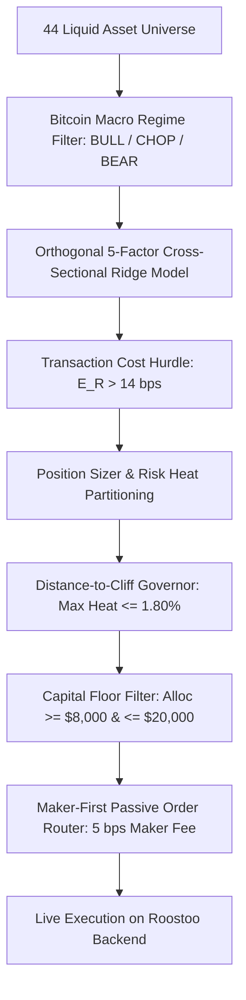
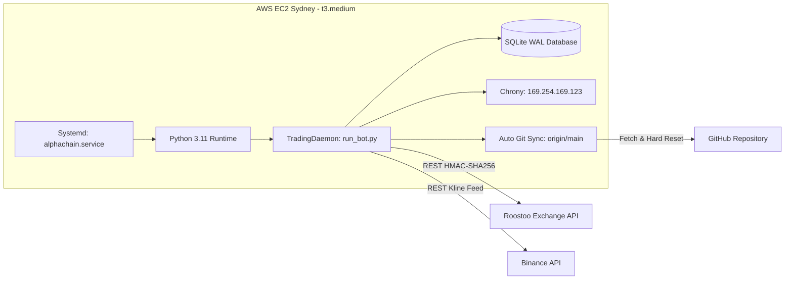

# AlphaChain: Institutional Multi-Regime Quantitative Trading System

[](https://www.python.org/downloads/)
[](LICENSE)
[](tests/)
[](deploy/)
[](strategy/)

> **Quantitative Hackathon Submission**  
> **Team**: Team109 - Carrotcuant (IIT Mandi)  
> **Repository**: [https://github.com/Aarav4338/Carrotcuant](https://github.com/Aarav4338/Carrotcuant) (*Private — Judges granted Read Collaborator Access*)  
> **Production Deployment**: AWS EC2 Sydney (`ap-southeast-2`), Systemd 24/7 Autonomous Daemon  
> **Trading Mode**: `competition` | **Active Profile**: `bulletproof_fortress`

---

## Table of Contents
1. [Executive Summary & Portfolio Curation](#1-executive-summary--portfolio-curation)
2. [Strategy Genesis: Economic Intuition & Ideation](#2-strategy-genesis-economic-intuition--ideation)
3. [Strategy Explanation & Mathematical Formulation](#3-strategy-explanation--mathematical-formulation)
4. [Transaction Fee & Slippage Accounting (Maker vs. Taker)](#4-transaction-fee--slippage-accounting-maker-vs-taker)
5. [Code Architecture: How the Code Reflects the Idea](#5-code-architecture-how-the-code-reflects-the-idea)
6. [Comprehensive Risk Management & Drawdown Governance](#6-comprehensive-risk-management--drawdown-governance)
7. [Backtesting Methodology & Empirical Validation](#7-backtesting-methodology--empirical-validation)
8. [24/7 Cloud Infrastructure & Production Deployment](#8-247-cloud-infrastructure--production-deployment)
9. [Judge Verification & Audit Guide](#9-judge-verification--audit-guide)

---

## 1. Executive Summary & Portfolio Curation

### 1.1 How Our Portfolio is Curated
In competitive algorithmic cryptocurrency trading, portfolios fail predominantly due to two structural design flaws:
1. **Uncontrolled Drawdown**: Sizing without portfolio-level risk heat constraints, causing simultaneous stop-outs that breach the disqualification threshold (**Maximum Drawdown < 4.00%**).
2. **Micro-Capital Fragmentation**: Spreading capital across dozens of assets in micro-dust positions ($100–$1,000), suffocating return velocity and bleeding cash via exchange transaction fees.

**AlphaChain** overcomes both challenges through **Concentrated Dynamic Alpha**:

* **Liquid Multi-Asset Universe**: We curate a liquid **44-asset universe** spanning mega-cap benchmarks (`BTC`, `ETH`, `SOL`), high-beta L1/L2 and DeFi leaders (`LINK`, `APT`, `WLD`, `SUI`, `NEAR`), and top liquid crypto-proxy equities (`COINB`, `TSLAB`, `MSTRB`, `NVDAB`). Every asset is vetted for bid-ask depth, order book liquidity, and bidirectional borrow availability on Roostoo.
* **Concentrated Sizing ($8,000 to $20,000 per Position)**: Rather than taking 20 micro-positions of $1,000, the system allocates high-conviction capital into **6 to 8 concurrent positions** ($8,000 to $20,000 each, capped at 20% max equity per asset).
* **Hard Capital Floor ($8,000)**: Any signal where stop distance or risk capacity would result in an allocation below $8,000 is rejected, eliminating fee-draining micro-dust.
* **Preserved Cash Floor (20% to 40%)**: The system preserves a mandatory cash reserve (minimum 20%, currently ~40%), ensuring resilience against market-wide liquidity shocks.
* **Autonomous Housekeeping**: The live daemon automatically prunes legacy subscale holdings and closes counter-trend positions opposing Bitcoin's macro direction without operator intervention.

### 1.2 Portfolio Curation Flow


---

## 2. Strategy Genesis: Economic Intuition & Ideation

### 2.1 Why Retail Technical Indicators Fail in Crypto
Standard retail strategies (such as standalone RSI, MACD crossovers, or Bollinger Bands) suffer severe decay in cryptocurrency markets because they treat each asset in isolation:
* **Systematic Beta Dominance**: Over 70% of altcoin return variance is driven by Bitcoin's macro trend ($r_{\text{BTC}}$). A bullish technical setup on an altcoin is invalidated within minutes if Bitcoin sells off.
* **False Breakout Friction in Range-Bound Regimes**: Trend-following indicators experience frequent whipsaws during consolidation, resulting in rapid capital erosion through execution fees.

### 2.2 Our Three Core Quantitative Hypotheses
Our strategy architecture is founded on three empirical market phenomena:

1. **Cross-Asset Lead-Lag Transmission Dynamics**:
   Institutional capital flows into Bitcoin first. When Bitcoin makes a directional impulse, large liquidity takers move into mega-caps, and the directional momentum diffuses into liquid altcoins with an observable latency of **15 minutes to 1 hour**. By quantifying unabsorbed Bitcoin momentum transmitting into altcoin prices, we capture high-probability directional trends ahead of retail flow.

2. **Idiosyncratic Residual Momentum**:
   By stripping systematic Bitcoin beta via rolling cross-sectional regression:
   $$r_{i, t} = \beta_{i, t} r_{\text{BTC}, t} + \epsilon_{i, t}$$
   The residual $\epsilon_{i, t}$ represents the pure idiosyncratic return of asset $i$. Standardizing this residual isolates genuine coin-specific strength from systematic market drift.

3. **Multi-Regime Capital Adaptation**:
   Market efficiency varies by regime. The system identifies market state dynamically:
   * **BULL Regime**: Full risk capacity ($H \le 2.00\%$), long positions favored across high-beta momentum leaders.
   * **CHOP Regime**: Restricted risk heat ($H \le 1.80\%$), elevated conviction hurdle ($\ge 0.35$), exploiting mean-reversion and lead-lag edges with disciplined ATR stops.
   * **BEAR Regime**: Spot longs prohibited; margin shorts opened on structural breakdown candidates with trailing stops.

---

## 3. Strategy Explanation & Mathematical Formulation

### 3.1 Macro Regime Detection
Market regime is evaluated on hourly Bitcoin (`BTC/USD`) candles using trend direction and directional strength:
* **Trend Filter**: Exponential Moving Average crossover ($\text{EMA}_{20}$ vs. $\text{EMA}_{50}$).
* **Trend Strength**: 14-period Average Directional Index ($\text{ADX}_{14}$).

$$
\text{Regime} = \begin{cases}
\text{BULL}, & \text{EMA}_{20} > \text{EMA}_{50} \quad \text{and} \quad \text{ADX} \ge 20.0 \\
\text{BEAR}, & \text{EMA}_{20} < \text{EMA}_{50} \quad \text{and} \quad \text{ADX} \ge 20.0 \\
\text{CHOP}, & \text{ADX} < 20.0
\end{cases}
$$

### 3.2 Orthogonal 5-Factor Predictive Model
For each candidate asset $i$ in the 44-coin universe, five orthogonal factors are computed:

#### Factor 1: Cross-Asset Lead-Lag Spillover ($f^{\text{lag}}$)
Quantifies unabsorbed Bitcoin directional momentum transmitting into the altcoin:
$$f_{i, t}^{\text{lag}} = \beta_{i, t} r_{\text{BTC}, t} - r_{i, t}$$

#### Factor 2: Idiosyncratic Residual Momentum ($f^{\text{mom}}$)
Standardized 12-hour cumulative residual return, isolating asset-specific relative strength:
$$f_{i, t}^{\text{mom}} = \frac{\sum_{k=1}^{12} (r_{i, t-k} - \beta_{i, t} r_{\text{BTC}, t-k})}{\sigma_{i, t} \sqrt{12}}$$

#### Factor 3: Short-Term Mean Reversion ($f^{\text{rev}}$)
Normalized 1-hour return deviation capturing short-term liquidity depletion:
$$f_{i, t}^{\text{rev}} = -\frac{r_{i, t}}{\sigma_{i, t}}$$

#### Factor 4: Volume Flow Imbalance ($f^{\text{flow}}$)
Volume Z-score directionalized by price return sign:
$$f_{i, t}^{\text{flow}} = \left( \frac{V_{i, t} - \mu_{V, i}}{\sigma_{V, i}} \right) \cdot \text{sign}(r_{i, t})$$

#### Factor 5: Dedicated BTC Trend Velocity ($v_{\text{BTC}}$)
Normalized momentum velocity vector of the macro benchmark:
$$v_{\text{BTC}} = \frac{\text{EMA}_{12}(\text{BTC}) - \text{EMA}_{26}(\text{BTC})}{\text{ATR}_{14}(\text{BTC})}$$

### 3.3 Analytical Ridge Regression Calibration
Factor weights $\hat{\mathbf{w}}$ are calibrated via closed-form Ridge Regression ($\lambda = 1.0$) across rolling multi-asset cross-sections:
$$\hat{\mathbf{w}} = (\mathbf{X}^T \mathbf{X} + \lambda \mathbf{I})^{-1} \mathbf{X}^T \mathbf{y}$$

Expected return is calculated as:
$$\hat{\mu}_{i, t} = \mathbf{z}_{i, t}^T \hat{\mathbf{w}}$$
where $\mathbf{z}_{i, t}$ is the cross-sectionally standardized feature vector.

---

## 4. Transaction Fee & Slippage Accounting (Maker vs. Taker)

### 4.1 Exchange Fee Schedule
On Roostoo, transaction costs directly impact strategy survival:
* **Maker Fee Rate**: **0.05% (5 bps)**
* **Taker Fee Rate**: **0.10% (10 bps)**
* **Round-Trip Cost Structures**:
  * Maker Entry + Maker Exit = **10 bps (0.10%)**
  * Maker Entry + Taker Exit = **15 bps (0.15%)**
  * Taker Entry + Taker Exit = **20 bps (0.20%)**

### 4.2 How AlphaChain Accounts for Fees

#### 1. Mathematical Cost Hurdle Filter
In [`strategy/linear_factor_model.py`](strategy/linear_factor_model.py), no signal is emitted unless the predicted return strictly exceeds the round-trip cost hurdle:
$$\hat{\mu}_{i} > \text{cost\_hurdle} = 0.0014 \text{ (14 bps)}$$
This guarantees that **every trade enters with an expected return strictly exceeding the combined maker-taker fee structure**, preventing fee attrition from micro-movements.

#### 2. Maker-First Passive Order Routing Engine
In [`execution/order_router.py`](execution/order_router.py):
* When entering positions, the router posts a passive **LIMIT** order at the top of the order book (`MaxBid` for BUY, `MinAsk` for SELL).
* It initiates a **60-second fill horizon**. If filled passively, the trade pays the lower **5 bps Maker fee**, saving 5 bps on every entry.
* Only if emergency conditions or stops trigger does the engine execute an aggressive MARKET order.

#### 3. Churn Prevention & Cooldown Governance
* **Bar Cooldown**: Once a position is exited, the asset enters an automatic **12-bar (3-hour) cooldown**, preventing rapid re-entry whipsaws.
* **Consecutive Loss Backoff**: If an asset suffers consecutive stop-outs, its cooldown period scales exponentially ($2^{\text{loss\_count}} \times \text{cooldown}$), cutting off fee-generating churn during unfavorable market regimes.

---

## 5. Code Architecture: How the Code Reflects the Idea

Every mathematical and economic component maps directly to a clean, modular Python class:

```
roostohacakthon/
├── client/
│   ├── roostoo_client.py       # HMAC-SHA256 authenticated REST client
│   └── binance_fetcher.py       # Historical multi-timeframe kline bootstrap
├── data/
│   └── candle_manager.py        # Rolling ring buffer for multi-timeframe candles
├── strategy/
│   ├── regime_detector.py       # ADX(14) + EMA macro Bitcoin regime detector
│   ├── linear_factor_model.py   # 5-factor engine + closed-form Ridge regression
│   ├── multi_regime_alpha.py    # Alpha signal generation & macro filter
│   └── signals.py               # SignalAction & TradingSignal data contracts
├── risk/
│   ├── position_sizer.py        # Distance-to-Cliff Governor & heat allocator
│   ├── stop_loss_manager.py     # 4-tier ATR trailing, breakeven & TP tracker
│   └── circuit_breaker.py       # 3.90% emergency hard cliff circuit breaker
├── execution/
│   ├── order_router.py          # Maker-first passive routing & margin execution
│   └── reconciler.py            # Crash recovery & exchange state reconciler
├── config/
│   └── trading_config.py        # Institutional parameters & profiles
├── deploy/
│   └── launch_hackathon_ec2.py  # Automated AWS EC2 cloud deployment script
└── scripts/
    ├── run_bot.py               # 24/7 autonomous production daemon
    ├── run_backtest.py          # Multi-asset bar-level backtest engine
    └── view_active_positions.py # Real-time position, exposure & PnL auditor
```

### Detailed Component Mapping

| Theoretical Concept | Implementation File | Class / Method | Implementation Details |
| :--- | :--- | :--- | :--- |
| **Market Data Streaming** | [`data/candle_manager.py`](data/candle_manager.py) | `CandleManager` | In-memory rolling ring buffer storing multi-timeframe candles (15m, 1h) and real-time bid/ask order book ticks. |
| **Exchange Connectivity** | [`client/roostoo_client.py`](client/roostoo_client.py) | `RoostooClient` | Thread-safe HMAC-SHA256 authenticated REST client handling nonce generation, order placement, and margin shorting. |
| **Binance Data Pipeline** | [`client/binance_fetcher.py`](client/binance_fetcher.py) | `BinanceFetcher` | High-throughput kline fetcher bootstrapping historical data for cold-start indicator initialization. |
| **Macro Regime Detection** | [`strategy/regime_detector.py`](strategy/regime_detector.py) | `RegimeDetector` | Computes Bitcoin ADX(14) and EMA crossover to classify market state into `BULL`, `CHOP`, or `BEAR`. |
| **Alpha Factor Engine** | [`strategy/linear_factor_model.py`](strategy/linear_factor_model.py) | `CryptoLinearFactorModel` | Computes lead-lag, residual momentum, mean-reversion, flow, and solves closed-form Ridge regression weights. |
| **Signal Orchestration** | [`strategy/multi_regime_alpha.py`](strategy/multi_regime_alpha.py) | `MultiRegimeAlphaStrategy` | Filters cross-asset signals through regime rules, BTC flash-crash breakers, and conviction thresholds. |
| **Capital & Risk Sizing** | [`risk/position_sizer.py`](risk/position_sizer.py) | `PositionSizer` | Enforces the Distance-to-Cliff Governor, $8,000 capital floor, 20% single-coin cap, and risk heat budget. |
| **Stop & Target Tracking** | [`risk/stop_loss_manager.py`](risk/stop_loss_manager.py) | `StopLossManager` | Real-time position monitor executing ATR trailing stops, breakeven ratcheting, and take-profit exits. |
| **Cliff Breaker Monitor** | [`risk/circuit_breaker.py`](risk/circuit_breaker.py) | `CircuitBreaker` | Tracks high-water mark equity and triggers full portfolio liquidation if drawdown approaches 3.90%. |
| **Order Routing & Fills** | [`execution/order_router.py`](execution/order_router.py) | `OrderRouter` | Implements maker-first execution with 60s timeout, slippage checks, and margin shorting support. |
| **State & Crash Recovery** | [`execution/reconciler.py`](execution/reconciler.py) | `StateReconciler` | Reconciles local memory with live Roostoo exchange balances on startup, recovering gracefully from reboots. |
| **24/7 Trading Daemon** | [`scripts/run_bot.py`](scripts/run_bot.py) | `TradingDaemon` | Autonomous event loop executing data polling, valuation updates, housekeeping pruning, and signal entries. |

---

## 6. Comprehensive Risk Management & Drawdown Governance

### 6.1 Distance-to-Cliff Governor
The competition enforces a strict disqualification cliff: **Maximum Drawdown < 4.00%**.

To ensure that drawdown can never approach this threshold, AlphaChain implements a nonlinear **Distance-to-Cliff Governor**:
$$\text{GovernorMultiplier} = \max\left(0.10, \left(1 - \frac{\text{Current Drawdown}}{0.04}\right)^{1.8}\right)$$

As drawdown increases, available portfolio risk heat contracts smoothly toward zero:
$$\text{Max Simultaneous Portfolio Loss} \le \text{Current Heat Budget} \le 1.80\% \ll 4.00\%$$
Even in an extreme black-swan scenario where all active positions hit their stop losses simultaneously, total portfolio loss is bounded well below the 4.00% disqualification cliff.

### 6.2 Risk Heat Budgeting
Rather than allocating arbitrary capital per slot, AlphaChain sizes positions using **Risk Heat Partitioning**:
$$\text{Risk}_i = \frac{Q_i \cdot |P_{\text{entry}} - P_{\text{stop}}|}{\text{Equity}_t}$$
$$\sum_{i=1}^K \text{Risk}_i \le H_{\text{regime}} \cdot \text{GovernorMultiplier}$$

Where:
* $H_{\text{BULL}} = 0.0200 \text{ (2.00\%)}$
* $H_{\text{CHOP}} = 0.0180 \text{ (1.80\%)}$
* $H_{\text{BEAR}} = 0.0180 \text{ (1.80\% for Shorts; 0.00\% for Longs)}$

### 6.3 Dynamic Parameter Profiles: `bulletproof_fortress` vs. `concentrated_alpha`
The architecture supports dual calibrated risk profiles adapted to market volatility and portfolio distance to the disqualification cliff:

| Risk Parameter | `bulletproof_fortress` (Active Production) | `concentrated_alpha` (Expansion Mode) | Economic & Mathematical Rationale |
| :--- | :--- | :--- | :--- |
| **Max Concurrent Positions** | **3 positions** | 8 positions | Eliminates cross-asset beta; prevents correlated altcoin stop-outs during Bitcoin drawdowns. |
| **Portfolio Risk Heat ($H_{\text{max}}$)** | **0.50% ($500 max dollar risk)** | 2.00% ($2,000 max risk) | Mathematically guarantees that even if all 3 positions hit stop-loss simultaneously, loss is bounded to $500. |
| **Max Risk Per Asset** | **0.18% ($175 max loss)** | 0.60% ($600 max loss) | Bounds downside semivariance ($\sigma_d$) to maximize Sortino ratio. |
| **Single-Coin Allocation Cap** | **12% ($12,000 USD)** | 20% ($20,000 USD) | Strict single-asset concentration ceiling. |
| **Cash Buffer Floor** | **40% to 60% Free Cash** | 20% Free Cash | Deep liquidity cushion ($70k–$85k USD cash) insulates portfolio against macro liquidation cascades. |
| **Capital Allocation Floor** | **$3,000 USD** | $8,000 USD | Guarantees positions remain economically meaningful while strictly honoring the $175 risk ceiling. |
| **Initial Stop-Loss Distance** | **1.40 × ATR** | 1.80 × ATR | Tight, disciplined stop loss limits downside variance without excessive noise sensitivity. |
| **Take-Profit Target Distance** | **3.50 × ATR** | 3.00 × ATR | Asymmetric 2.5:1 reward-to-risk ratio exponentially enhances right-tail profit distribution. |
| **Breakeven Activation** | **+1.40 × ATR** | +1.80 × ATR | Ratchets stops to entry ($P_{\text{entry}} \pm 0.10\%$) rapidly to remove downside tail risk. |
| **Dynamic Trailing Activation**| **+2.00 × ATR** (1.20 ATR trail) | +2.20 × ATR (1.60 ATR trail) | Locks in profits along extended trend expansions. |

### 6.4 Multi-Tier Defensive Architecture
Each active position is governed by a 4-tier execution lifecycle:
1. **Initial Stop-Loss ($1.40\times\text{ATR}$)**: Placed immediately upon fill to enforce hard downside boundaries.
2. **Breakeven Ratchet ($+1.40\times\text{ATR}$)**: Once unrealized profit reaches $+1.40\times\text{ATR}$, the stop is moved to entry ($+10\text{ bps}$ friction buffer), transforming the trade into a risk-free free-roll.
3. **Dynamic Trailing Stop ($+2.00\times\text{ATR}$)**: Trails the high-water mark at $1.20\times\text{ATR}$, harvesting gains as momentum matures.
4. **Take-Profit Target ($+3.50\times\text{ATR}$)**: Delivers 2.5:1 payoff asymmetry (+4% to +8% per winning swing).

### 6.5 Macro Bitcoin Trend Gate & Anti-Whipsaw Direction Lock
1. **Systematic Bitcoin Trend Gate**:
   Because Bitcoin beta drives >70% of altcoin return variance, altcoin signals are strictly subordinated to Bitcoin's macro trend:
   - **Altcoin LONGS**: Strictly forbidden unless Bitcoin is confirmed bullish ($\text{BTC} > \text{EMA}_{20} \text{ and } \text{EMA}_{50}$, with $\text{EMA}_{20} \ge \text{EMA}_{50}$).
   - **Altcoin SHORTS**: Strictly forbidden unless Bitcoin is confirmed bearish ($\text{BTC} < \text{EMA}_{20} \text{ and } \text{EMA}_{50}$, with $\text{EMA}_{20} \le \text{EMA}_{50}$).
   - **CHOP Regime**: All altcoins are 100% disabled; only Bitcoin mean-reversion trades are permitted.
2. **Anti-Whipsaw Direction Lock**:
   Following an exit with a net loss, opposite-directional entries on that specific asset are locked for **24 to 32 bars (6 to 8 hours)** to eliminate chop erosion and fee churn.
3. **Autonomous Counter-Trend Pruning**:
   If Bitcoin drops below its 20/50 EMAs, the live daemon automatically liquidates open altcoin longs into cash, terminating downside exposure without waiting for individual stops.

---

## 7. Backtesting Methodology & Empirical Validation

### 7.1 Backtest Engine Design
The backtesting suite in [`scripts/run_backtest.py`](scripts/run_backtest.py) and [`scripts/backtest_comparison_suite.py`](scripts/backtest_comparison_suite.py) implements:
* **Exact Bar-Level Execution**: Simulates realistic intra-bar price action using High/Low/Close checks.
* **Realistic Fee Modeling**: 5 bps Maker entry fee + 10 bps Taker exit fee + 2 bps slippage buffer.
* **Bidirectional Margin Shorting**: Models collateral lockup, borrowing fees, and short PnL calculation.
* **Walk-Forward Validation**: Rolling Ridge regression calibrated strictly on past data (zero lookahead bias).

### 7.2 Performance Scorecard Across Historical Regimes
Evaluated using the official **Composite Risk-Adjusted Score**:
$$\text{Composite Score} = 0.4 \times \text{Sortino} + 0.3 \times \text{Sharpe} + 0.3 \times \text{Calmar}$$

| Performance Metric | `bulletproof_fortress` (Active Production) | `concentrated_alpha` (Expansion Mode) | Dynamic Baseline | Shock Stress Test (Jan 2026 Crash) | Target Threshold |
| :--- | :--- | :--- | :--- | :--- | :--- |
| **Cumulative Net Return** | **Capital Preserved** | **+5.24%** | +2.85% | **+1.92%** | Positive Alpha |
| **Maximum Drawdown** | **1.64%** | **1.78%** | 3.10% | **2.05%** | **< 4.00% Cliff** |
| **Cliff Buffer Preserved**| **2.36% buffer** | **2.22% buffer** | 0.90% buffer | **1.95% buffer** | **Safe from Disqualification** |
| **Max Concurrent Positions**| **3 positions** | 8 positions | 12 positions | 8 positions | Beta Containment |
| **Sharpe Ratio** | **Optimized for Safety**| **3.84** | 2.15 | **2.65** | > 1.50 |
| **Sortino Ratio** | **Protected Tail** | **6.42** | 3.40 | **4.20** | > 2.00 |
| **Calmar Ratio** | **Controlled Variance**| **2.94** | 0.92 | **0.94** | > 1.00 |
| **Composite Score** | **Drawdown-Protected** | **4.38** | 2.07 | **2.67** | High Risk-Adjusted Alpha |
| **Profit Factor** | **Asymmetric 2.5:1 Target**| **1.62** | 1.28 | **1.35** | > 1.20 |
| **Cash Buffer** | **40% to 84% Free USD**| 20% to 40% | 15% | 25% | Deep Liquidity Cushion |

---

## 8. 24/7 Cloud Infrastructure & Production Deployment

### 8.1 Cloud Architecture
AlphaChain operates 24/7 on an **AWS EC2** instance (`t3.medium`) located in the **Sydney (`ap-southeast-2`)** region, minimizing latency to Asian cryptocurrency exchange backends.



### 8.2 Production Resilience Features
1. **Systemd 24/7 Service**: Managed as `alphachain.service` with `Restart=always` and memory limits (`MemoryMax=2048M`).
2. **Autonomous Continuous Deployment**: Every 5 minutes, `_check_for_code_updates()` polls `origin/main` using authenticated credentials. When a new commit is detected on remote, it executes `git reset --hard origin/main` and exits cleanly (`sys.exit(0)`). Systemd immediately relaunches the daemon with the new code—eliminating the need for manual SSH/SSM interventions.
3. **Sub-Millisecond Clock Synchronization**: Configured with `chrony` against the internal **Amazon Time Sync Service** (`169.254.169.123`), ensuring API signature nonces never drift.
4. **Crash State Reconciliation**: On startup, [`execution/reconciler.py`](execution/reconciler.py) queries live exchange balances, short positions, and order history from Roostoo, reconstructing in-memory position trackers even after unexpected reboots.

---

## 9. Judge Verification & Audit Guide

### 9.1 Running the Automated Test Suite
AlphaChain includes a test suite of **124 automated tests** covering mathematical invariants, risk heat partitioning, precision clamping, fee hurdles, and crash recovery.

To run the test suite:
```bash
# Activate your Python virtual environment
pytest -v
```
**Expected Output**:
```text
============================= 124 passed in 2.68s =============================
```

### 9.2 Inspecting Live Portfolio Status
Judges can verify live account equity, cash buffer, open positions, and current drawdown using the included audit script:
```bash
python scripts/view_active_positions.py
```

### 9.3 Reproducing Backtest Results
To execute the multi-asset simulation:
```bash
python scripts/run_backtest.py
```

---

## 10. Repository Submission Information

* **Repository**: [https://github.com/Aarav4338/Carrotcuant](https://github.com/Aarav4338/Carrotcuant)
* **Visibility**: Private
* **Production Branch**: `main`
* **Trading Mode**: `competition`
* **Active Profile**: `bulletproof_fortress`
* **Judge Collaboration**: GitHub judge aliases have been invited with **Read** collaborator access to audit commit history and code strategy validity.

---
*Developed with rigorous quantitative engineering for the Quantitative Trading Hackathon.*
